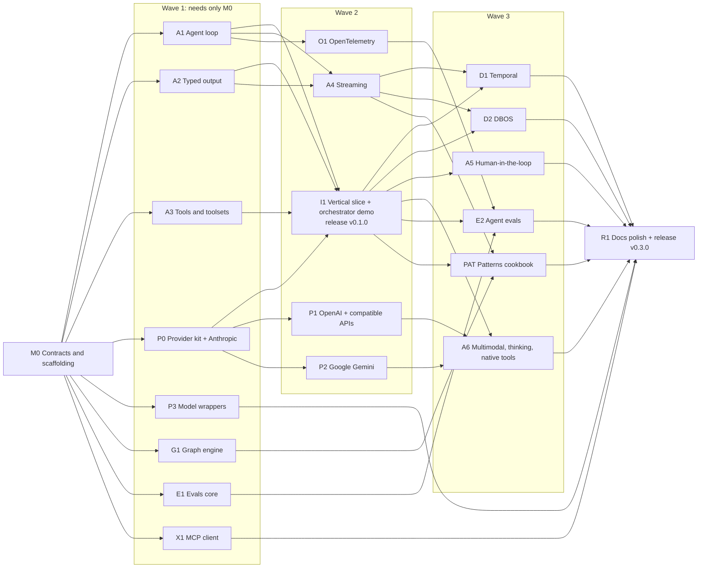

# Gogent: design and milestone plan

- **Date:** 2026-10-16
- **Owner:** Emad Mokhtar
- **Status:** Approved by the owner on 2026-10-16, including every decision tagged [proposed]
- **Repository:** `github.com/EmadMokhtar/gogent`

Every decision in this document has a source tag:

- **[owner]** means Emad decided it in the design conversation.
- **[proposed]** means Claude chose it. The owner should check it during review.

---

## 1. Summary

Gogent is a Go framework for building LLM (large language model) agents. It is
modeled on [PydanticAI](https://pydantic.dev/docs/ai/overview/) V2. It covers the
agent loop, tools, typed output, many model providers, a graph engine, evals,
an MCP (Model Context Protocol) client, observability, and durable execution.

The work is split into 21 milestones in four waves. Each wave can run as several
Claude Code sessions at the same time. Each session owns its own directories,
so sessions do not edit the same files.

The first program built on Gogent is an **orchestrator demo**: one agent splits a
task into subtasks, worker agents run the subtasks concurrently, and a final
agent merges the results.

## 2. Why this project exists [owner]

1. Get experience writing a framework, not only using one.
2. Learn how agents work from the inside, by building one from scratch.
3. Use Go's concurrency model (goroutines, channels, `context`) where it gives a
   real advantage over Python.
4. Enjoy building with Go again.

Goal 1 and goal 2 shape the plan. Parallel Claude Code sessions do most of the
typing, so the learning must come from other places:

- The owner approves the public API sketches in this document during review,
  and each milestone's exact signatures through an "API-first" step in its PR
  (section 7, rule 8).
- Each milestone lists **"Review focus"**: the parts of the code worth reading
  closely, because they hold the lesson.
- Claude sessions build every milestone, including the agent loop (A1) and
  the graph engine (G1). [owner] This keeps the fastest schedule; the
  API-first review and the "Review focus" notes carry the learning.

## 3. Goals, non-goals, anti-goals

### 3.1 Goals [owner]

- **Agent loop** that supports most agentic patterns: prompt chaining, routing,
  parallel fan-out, orchestrator-workers, evaluator-optimizer, the autonomous
  tool loop, and delegation between agents.
- **Graph engine**, modeled on the `pydantic-graph` builder API.
- **Evals**, modeled on `pydantic-evals`.
- **MCP client.** No MCP server.
- **Generic model-provider interface**, so outside people can contribute
  providers.
- **Durable execution** with Temporal and DBOS.
- **Observability** with OpenTelemetry.
- **Reuse before rebuild.** Use an existing Go package wherever one does the job.
  Build by hand only the agent loop, the provider interface, the tool system,
  typed output, the graph engine, and the evals framework.
- **Official vendor SDKs** for model providers, where they exist.

### 3.2 Non-goals [proposed unless marked]

These are out of scope for this plan. Any of them can become a later milestone.

- MCP server. [owner]
- A2A (agent-to-agent protocol), AG-UI and Vercel AI UI event streams, the web
  chat UI, and a CLI (command-line interface) chat tool.
- Realtime voice (speech-to-speech).
- The "Pydantic AI Harness" capability library: coder and researcher agents,
  sandboxes, SaaS connectors, memory, guardrails, planning.
- Agent specs (agents defined in YAML or JSON files).
- Image generation and embeddings.
- Durable backends other than Temporal and DBOS (Prefect, Restate, AWS Lambda,
  Airflow, and others).
- Graph persistence. PydanticAI V2 removed it. Durable graphs can come later
  through Temporal or DBOS.
- The RAG (retrieval-augmented generation) and memory systems from the earlier
  Copilot branches (see section 9.2).
- Pydantic Logfire as a special integration. Logfire accepts OTLP (the
  OpenTelemetry wire protocol), so the generic OpenTelemetry support covers it.

### 3.3 Anti-goals [proposed]

The project fails if it works but has any of these properties:

- **Python written in Go syntax.** Examples: decorators faked with reflection
  tricks, `map[string]any` in a public API where a struct type would work, or
  hidden global state. (The opt-in model registry in decision 9 is the one
  allowed global.)
- **A heavy core.** Importing the core module must not download any vendor SDK,
  Temporal, DBOS, or OpenTelemetry exporter.
- **Data races or goroutine leaks.** Any failure of the race detector or of a
  goroutine-leak check blocks a release.
- **Tests that need live API keys in CI** (continuous integration).
- **An API nobody approved.** No public API is merged without owner approval.

## 4. Constraints

- **Language:** Go **1.27 or later**. The `go` directive in every `go.mod` is
  `go 1.27`. [proposed] Reasons:
  - Go 1.26 is the lowest possible choice anyway: OpenTelemetry Go, the
    Temporal SDK, `golang.org/x/sync`, `golang.org/x/time`, and `openai-go/v3`
    already require it.
  - Go 1.27 adds **generic methods** (a method on a concrete type may declare
    its own type parameters; interface methods still cannot). This allows a
    per-run output type (decision 1).
  - Go 1.27 makes `encoding/json/v2` and `encoding/json/jsontext` generally
    available. `jsontext` reads JSON token by token, which the partial JSON
    parser in A2 needs.
  - Cost: users still on Go 1.26 cannot use Gogent. Go 1.26 leaves support when
    Go 1.28 ships in February 2027, which is before Gogent is likely to have
    many users.
  - CI tests Go 1.27, and adds each new Go release when it ships.
- **Module path:** `github.com/EmadMokhtar/gogent`. [proposed, follows the
  existing repository]
- **License:** MIT, as in the existing repository.
- **No pre-release dependencies.** No `-alpha`, `-beta`, or `-rc` versions in any
  `go.mod`. [owner, from an earlier project rule]
- **Conventional Commits** for every commit message and every PR (pull request)
  title. Each PR links to a GitHub issue and is assigned to `EmadMokhtar`.
  [owner]
- **No experimental Go features** (no `GOEXPERIMENT` flags). [proposed]
- **Libraries do not log.** The framework reports what happens through
  OpenTelemetry and through returned errors. [proposed]

## 5. Architecture

### 5.1 Repository and module layout [proposed]

The repository holds several Go modules (a "multi-module repository"). A Go
module is the unit that has its own `go.mod`, its own dependencies, and its own
version tags.

```text
gogent/                         module github.com/EmadMokhtar/gogent  (core)
├── agent.go, run.go, ...       package gogent: Agent, Run, Iter, options
├── message/                    messages and parts, JSON encoding
├── model/                      Model interface, settings, usage, profile, registry
│   ├── modeltest/              TestModel, FunctionModel
│   │   └── conformance/        provider conformance test kit
│   └── fallback/, retry/, ...  model wrappers (P3)
├── tool/                       Tool, Toolset, function tools, combinators
├── output/                     output specs: tool, native, prompted, text
├── run/                        run.Context[D], usage limits
├── capability/                 Capability interface, hook stages, Hooks helper
├── runtime/                    Runtime interface, effects, default runtime
├── event/                      stream events (A4)
├── graph/                      graph engine (G1)
├── internal/loop/              the agent state machine (A1)
│
├── providers/anthropic/        module  (official Anthropic SDK)
├── providers/openai/           module  (official OpenAI SDK)
├── providers/google/           module  (official Google Gen AI SDK)
├── mcp/                        module  (official MCP Go SDK)
├── otel/                       module  (OpenTelemetry Go)
├── durable/temporal/           module  (Temporal Go SDK)
├── durable/dbos/               module  (DBOS Go SDK)
├── evals/                      module
├── examples/                   module
└── docs/                       MkDocs site
```

**Why several modules:**

- A user who needs only Anthropic does not download the OpenAI SDK, Temporal,
  or DBOS.
- Parallel sessions that add dependencies edit different `go.sum` files, so
  they do not get merge conflicts.
- It works like `database/sql` and its drivers: the core defines the interface,
  and providers live in separate modules. A contributor can publish a provider
  from their own repository.

**Cost:** each module gets its own version tags, for example
`providers/anthropic/v0.1.0`. Nested modules point at the local core with a
`replace` directive in their `go.mod`. Go ignores `replace` directives in
dependencies, so users are not affected. The OpenTelemetry Go project uses the
same approach. `go.work` stays out of version control, as the current
`.gitignore` already says.

### 5.2 Key design decisions

Each decision states the choice, the reason, and the cost.

#### Decision 1: Non-generic contracts, generic edges [proposed]

The core interfaces (`model.Model`, `tool.Tool`, `tool.Toolset`,
`capability.Capability`, `output.Spec`) are **not** generic. Generic
constructors at the edges give users type safety: `gogent.New[Deps, Out]`,
`tool.Func[Deps, Args, Result]`, `output.Of[T]`.

- **Why:** interface methods cannot have type parameters, even in Go 1.27.
  If `Toolset` were generic over the dependency type, then every toolset,
  including an MCP toolset that never reads dependencies, would need that type
  parameter.
- **How type safety survives:** each typed tool reports the dependency type it
  expects. `gogent.New` checks that every tool expects the agent's `Deps` type
  and returns an error if not. The mismatch is found when the agent is built,
  not in the middle of a run.
- **Cost:** one check at construction time instead of a compile-time check.
- **Per-run output type:** an agent has a default output type `Out`. Go 1.27
  generic methods allow a per-run override, such as
  `agent.RunAs[Summary](ctx, deps, prompt)`. This matches PydanticAI's per-run
  `output_type`.

#### Decision 2: The agent loop is a "sans-I/O" state machine [proposed]

"Sans-I/O" means the core logic does no input or output itself. The agent
loop in `internal/loop` is a deterministic state machine. It never calls a
model, a tool, the clock, or the `go` keyword. It receives events ("the model
answered with this response", "these tool calls returned these results") and
returns **effects** ("request the model with these messages", "call these
tools", "finish with this output").

A **driver** executes the effects through a `runtime.Runtime`:

- The default runtime uses goroutines and `errgroup` (a helper that runs a group
  of goroutines and returns the first error).
- The Temporal runtime (D1) uses `workflow.Go` and runs effects as Temporal
  activities.
- The DBOS runtime (D2) runs effects as DBOS steps and uses `dbos.Go` for
  parallel work.

- **Why:** Temporal workflow code must be deterministic. It must produce the
  same steps when Temporal replays it after a crash. In Temporal's Go SDK,
  workflow code must use `workflow.Context` instead of `context.Context` and
  `workflow.Go` instead of `go`. Python hides this with a special event loop.
  Go cannot hide it. A state machine that never does I/O is deterministic by
  construction, so the same loop runs everywhere.
- **Extra benefit:** the loop can be tested with plain table-driven tests. No
  fake model and no goroutines are needed.
- **Cost:** the loop reads less like a simple `for` loop. More design work is
  needed up front in M0 and A1.

This pattern is also called "functional core, imperative shell": pure logic
decides, and an outer layer performs the side effects.

**The effect set** (frozen in M0) [proposed]:

| Effect | What runs inside it |
|--------|---------------------|
| Request model | Dynamic instructions and system prompts; listing tools from every toolset (including MCP `list_tools`); tool `prepare` functions; history processors; the model-request hook chain; the model call itself. |
| Call tool | The tool-validate and tool-execute hook chains, then the tool function. One effect per tool call. The driver may run several at once. |
| Process output | Parsing, schema validation, the type's `Validate()` method, output validators, and the output hook chains. |
| Finish | Nothing. The run ends with its result. |

**The rule:** every user callback that might do I/O runs **inside** an effect.
Only run-level hooks, node-level hooks, and event observers run in the driver.
In a durable run, the driver is workflow code, so those three must be
deterministic. Everything else may do I/O freely, because it runs inside a
Temporal activity or a DBOS step.

**Hooks never cross a process boundary.** Hooks are closures, and closures
cannot be serialized. A durable worker registers the same agent definition by
name. Inside an activity, the effect handler looks up the agent by name and
rebuilds its hook chains locally. Only data crosses the boundary: messages,
tool calls, tool results, and dependencies that are serializable.

#### Decision 3: Hooks are middleware, capabilities are optional interfaces [proposed]

PydanticAI V2 has hook stages for the run, each loop node, the model request,
tool validation, tool execution, output validation, output processing, tool
preparation, deferred tool calls, and the event stream. Each stage has `wrap`,
`before`, `after`, and `error` hooks.

In Gogent, each stage is a **middleware chain**, the same idea as `net/http`
middleware: `func(next Handler) Handler`. A wrapper can change the input, call
`next`, change the output, or skip `next` to short-circuit. `before`, `after`,
and `error` hooks are small helpers built on top of `wrap`.

A **capability** is a reusable bundle of behavior. In Go it is a small base
interface plus **optional interfaces**. The framework checks for each optional
interface with a type assertion, as `net/http` does with `http.Flusher`:

```go
type Capability interface{ ID() string }

// Optional. The agent checks for each one with a type assertion.
type InstructionsProvider interface {
    Instructions(ctx context.Context, rc *run.Untyped) (string, error)
}
type ToolsetProvider interface{ Toolsets() []tool.Toolset }
type ModelRequestWrapper interface {
    WrapModelRequest(next ModelRequestHandler) ModelRequestHandler
}
type ToolExecuteWrapper interface {
    WrapToolExecute(next ToolExecuteHandler) ToolExecuteHandler
}
// ...one interface per hook stage, plus settings and event observers.
```

Ordering follows PydanticAI exactly: the first capability is the outermost
wrapper; `before` hooks run in capability order; `after` and `error` hooks run
in reverse order.

- **Why:** this is the idiomatic Go way to say "this component may also do X".
  A capability implements only what it needs.
- **Cost:** optional interfaces are not visible in a type's signature. Good
  documentation and a compile-time assertion in each capability
  (`var _ capability.ModelRequestWrapper = (*MyCap)(nil)`) are needed.

#### Decision 4: Durable execution uses wrapper types, not capabilities [proposed]

PydanticAI V2 makes durable execution a capability. In Go, a durable run needs
a different entry point (Temporal passes a `workflow.Context`), so a wrapper
type is clearer: `temporal.Wrap(agent, opts)` and `dbos.Wrap(agent, opts)`.

Inside a durable run:

- Each effect from decision 2 runs as one activity (Temporal) or one step
  (DBOS), with everything the effect table lists inside it.
- Run-level hooks, node-level hooks, and event observers run in workflow code.
  They must be deterministic. The documentation states this rule clearly.

#### Decision 5: Streaming uses `iter.Seq2` [proposed]

Streaming APIs return `iter.Seq2[event.Event, error]`. This is Go's
range-over-function iterator (Go 1.23 and later). The caller writes a normal
`for ... range` loop and can stop with `break`. When the caller stops, the
producer cleans up through `defer`. Channels stay internal.

- **Why:** a returned channel forces the caller to drain it, or the producing
  goroutine leaks. An iterator has no such trap.

#### Decision 6: Schemas from struct tags, validation in layers [proposed]

- JSON Schema for tool arguments and outputs is generated from Go structs with
  `github.com/google/jsonschema-go`. The MCP Go SDK uses the same library and
  the same version, so tool schemas from MCP servers and from Go code share
  one type.
- What the library reads from a struct:
  - The `json` tag gives the field name. A field with `omitempty` or `omitzero`
    is optional. Every other field is required.
  - The `jsonschema` tag is **only** the field description. It cannot express
    constraints such as minimum, maximum, enum, or pattern.
  - Structs get `additionalProperties: false`. This suits strict structured
    output modes.
- **Constraints:** a type can add constraints by implementing an optional
  method that edits its generated schema, for example
  `JSONSchema(s *jsonschema.Schema)`. Gogent calls it after inference. A2
  decides the exact name. [proposed]
- **Validation layers:**
  1. Decode the model's raw JSON into a generic value (`any`). The library
     validates decoded JSON values only, not Go structs.
  2. Validate that value against the resolved schema (drafts 2020-12 and 07).
     Errors become a retry prompt that tells the model exactly what was wrong.
  3. Decode the JSON into the Go type.
  4. If the type has a `Validate() error` method, call it. This is the Go
     version of a Pydantic validator, for rules a schema cannot express.
  5. Agent-level output validators run last.
- No `go-playground/validator` in the core. Users may call it inside their own
  `Validate` methods. [proposed]

#### Decision 7: Errors [proposed]

- Errors are values that work with `errors.Is` and `errors.As`.
- `tool.Retry(msg)` asks the model to try again. It is the Go version of
  `ModelRetry`. `tool.Fail(msg)` reports a final tool failure without using the
  retry budget, like `ToolFailed`.
- Run errors include `*UsageLimitExceeded`, `*UnexpectedModelBehavior`, and
  `*model.APIError` (with HTTP status and a "retryable" flag).
- A panic inside user code (a tool, a hook, a validator) is recovered. The run
  stops with an error that includes the stack trace. The process does not crash.

#### Decision 8: Context and goroutine discipline [proposed]

- Every blocking call takes `context.Context` as its first parameter.
- No goroutine outlives the run that started it.
- Tests use `go.uber.org/goleak` to prove that no goroutine leaks.
- Every test suite runs with `-race`.

#### Decision 9: Model selection [proposed]

- Direct construction: `anthropic.New("claude-sonnet-5-5")`.
- Or by name: `model.Parse("anthropic:claude-sonnet-5-5")`. This uses a registry.
  Each provider module registers itself when the program imports it, as
  `database/sql` drivers do:
  `import _ "github.com/EmadMokhtar/gogent/providers/anthropic"`.

#### Decision 10: Graph engine [proposed]

- Gogent copies only the **builder API** of `pydantic-graph` V2: steps, edges,
  decisions, broadcast, map (fan-out over items), and joins with reducers.
- Edges are typed with generics, so connecting a step that outputs `A` to a step
  that expects `B` is a **compile error**.
- No `BaseNode`-style API. Python infers edges from return-type annotations; Go
  cannot, so that API would not feel natural in Go.
- Steps that run in parallel must not race on shared state. The builder of G1
  decides the mechanism (for example, an update function that runs under a
  lock), and the race detector must prove it.
- The graph does not depend on agents, the same as in Python.

#### Decision 11: Tooling [proposed]

- **Task runner:** `Makefile`, with targets that loop over all modules.
- **Lint:** `golangci-lint`. **Vulnerabilities:** `govulncheck`.
- **Docs:** Go doc comments and runnable `Example` functions are the API
  reference on pkg.go.dev. A MkDocs Material site holds guides. The site uses
  automatic navigation from the folder structure, so parallel sessions do not
  edit the same navigation file.
- **Releases:** release-please in manifest mode. Each module directory is one
  release-please "component", with `tag-separator: "/"`, which gives tags such
  as `providers/anthropic/v0.1.0`. Changelogs come from Conventional Commits.
  release-please does not update `require` lines between modules in the same
  repository, so M0 adds a small `make release-prep` target that does it. The
  OpenTelemetry Go project's `multimod` tool is the fallback if this proves
  fragile.

### 5.3 Public API sketches [proposed, owner to approve]

These sketches show the shape of the API. Names and details may change during
implementation, but only with owner approval.

**An agent with dependencies, a tool, and typed output:**

```go
type Deps struct {
    Weather WeatherClient
}

type Forecast struct {
    City    string `json:"city" jsonschema:"The city name"`
    Summary string `json:"summary" jsonschema:"One-sentence forecast"`
    TempC   int    `json:"temp_c"`
}

type WeatherArgs struct {
    City string `json:"city" jsonschema:"City to look up"`
}

getWeather := tool.Func("get_weather", "Get the current weather for a city.",
    func(ctx context.Context, rc *run.Context[Deps], a WeatherArgs) (string, error) {
        return rc.Deps.Weather.Lookup(ctx, a.City)
    })

agent, err := gogent.New[Deps, Forecast](
    anthropic.New("claude-sonnet-5-5"),
    gogent.WithInstructions("You are a weather assistant."),
    gogent.WithTools(getWeather),
)

res, err := agent.Run(ctx, Deps{Weather: client}, "What's the weather in Amsterdam?")
fmt.Println(res.Output.Summary, res.Usage().TotalTokens)
```

Notes on the sketch:

- Tool functions take `ctx context.Context` and `rc *run.Context[D]` as two
  separate parameters. Go's documentation advises against storing a
  `context.Context` inside a struct, so `run.Context` does not embed one.
- `Run` takes the dependencies as a typed positional parameter. Run options
  (message history, settings, limits) stay non-generic.

**Union output with a sealed interface:**

A "sealed interface" is an interface with an unexported method, so only types
in the same package can implement it. Go has no union types; this is the usual
replacement.

```go
type Reply interface{ isReply() }
type Answer struct{ Text string `json:"text"` }
type NeedsHuman struct{ Reason string `json:"reason"` }
func (Answer) isReply()     {}
func (NeedsHuman) isReply() {}

agent, err := gogent.New[Deps, Reply](m,
    gogent.WithOutput(output.OneOf[Reply](output.Case[Answer](), output.Case[NeedsHuman]())))

switch r := res.Output.(type) {
case Answer:     fmt.Println(r.Text)
case NeedsHuman: escalate(r.Reason)
}
```

**Step-by-step iteration (like `agent.iter`):**

```go
for node, err := range agent.Iter(ctx, deps, "Plan my trip") {
    if err != nil { return err }
    switch n := node.(type) {
    case *gogent.ModelRequestNode: log(n.Request)
    case *gogent.CallToolsNode:    log(n.Response)
    case *gogent.EndNode[Forecast]: use(n.Output)
    }
}
```

**Streaming:**

```go
for ev, err := range agent.RunStream(ctx, deps, "Write a haiku") {
    if err != nil { return err }
    switch e := ev.(type) {
    case event.TextDelta:   fmt.Print(e.Text)
    case event.ToolCalled:  fmt.Println("calling", e.Name)
    case event.Final[string]: fmt.Println("\ndone:", e.Output)
    }
}
```

**Graph with fan-out and join:**

```go
g := graph.NewBuilder[State, Deps, Topic, Report]()
plan := graph.Step(g, "plan", planQuestions)       // Topic -> []Question
research := graph.Step(g, "research", answerOne)   // Question -> Finding
collect := graph.Join(g, "collect", graph.Append[Finding]())
write := graph.Step(g, "write", writeReport)       // []Finding -> Report

graph.Edge(g, g.Start(), plan)
graph.Map(g, plan, research)   // each Question runs in its own goroutine
graph.Edge(g, research, collect)
graph.Edge(g, collect, write)
graph.Edge(g, write, g.End())

gr, err := g.Build()
report, err := gr.Run(ctx, &State{}, deps, Topic("Go generics"))
fmt.Println(gr.Mermaid())
```

**Evals:**

```go
ds := evals.Dataset[Question, Answer, Meta]{
    Cases: []evals.Case[Question, Answer, Meta]{
        {Name: "capital", Inputs: Question{"Capital of France?"}, Expected: &Answer{"Paris"}},
    },
    Evaluators: []evals.Evaluator[Question, Answer, Meta]{
        evals.EqualsExpected[Question, Answer, Meta](),
        evals.MaxDuration[Question, Answer, Meta](2 * time.Second),
    },
}
report, err := ds.Evaluate(ctx, answerQuestion, evals.WithConcurrency(8))
report.Print(os.Stdout)
```

**MCP, observability, durable execution:**

```go
srv := mcp.Stdio("uvx", "mcp-run-python", "stdio")    // or mcp.StreamableHTTP(url)
agent, err := gogent.New[Deps, string](m,
    gogent.WithToolsets(srv),
    gogent.WithCapabilities(otel.Instrumentation(otel.WithTracerProvider(tp))),
)

durable := temporal.Wrap(agent, temporal.Options{Name: "support"})
durable.Register(worker)                       // registers workflow and activities
// inside a Temporal workflow function:
res, err := durable.Run(wctx, deps, prompt)
```

**The orchestrator demo (first program):**

```go
plan, err := planner.Run(ctx, deps, task)   // Out = Plan{Subtasks []Subtask}
if err != nil { return err }

reports := make([]Report, len(plan.Output.Subtasks))
g, gctx := errgroup.WithContext(ctx)
g.SetLimit(4)                               // at most 4 workers at once
for i, st := range plan.Output.Subtasks {
    g.Go(func() error {
        r, err := worker.Run(gctx, deps, st.Prompt)
        if err != nil { return err }
        reports[i] = r.Output
        return nil
    })
}
if err := g.Wait(); err != nil { return err }

final, err := synthesizer.Run(ctx, deps, render(reports))
```

The demo also has a second version where the orchestrator is a single agent
that delegates through tool calls. The runtime then executes the parallel tool
calls concurrently. Comparing the two versions is part of the lesson:
programmatic orchestration versus model-driven orchestration.

## 6. Packages to reuse

Versions were checked on 2026-10-16 against `proxy.golang.org`. A session uses
the latest **stable** version when it starts, never a pre-release.

| Need | Package | Version | Notes |
|------|---------|---------|-------|
| Anthropic provider | `github.com/anthropics/anthropic-sdk-go` | v1.82.0 | Official SDK. |
| OpenAI provider and compatible APIs | `github.com/openai/openai-go/v3` | v3.78.0 | Official SDK. Needs Go 1.26 or later. |
| Google provider (Gemini API and Vertex AI) | `google.golang.org/genai` | v1.75.0 | Official SDK. |
| MCP client | `github.com/modelcontextprotocol/go-sdk` | v1.8.0 | Official SDK. Client transports: `CommandTransport` (subprocess), `StreamableClientTransport`, `SSEClientTransport`. |
| JSON Schema inference and validation | `github.com/google/jsonschema-go` | v0.4.3 | Same version the MCP SDK uses. See decision 6 for its limits. |
| JSON encoding and token reading | `encoding/json/v2`, `encoding/json/jsontext` | standard library | Generally available in Go 1.27. |
| Tracing and metrics | `go.opentelemetry.io/otel` and its SDK | v1.47.0 | See the GenAI note below. |
| Temporal | `go.temporal.io/sdk` | v1.50.0 | |
| Temporal tracing | `go.temporal.io/sdk/contrib/opentelemetry` | v0.8.1 | Use this one, not `contrib/opentelemetry-v2`, which Temporal's docs label "Pre-release". |
| DBOS | `github.com/dbos-inc/dbos-transact-golang` | v1.7.0 | `dbos.Context` is a `context.Context`. Concurrency inside a workflow uses `dbos.Go` and `dbos.Select`. The system database can be Postgres or SQLite. |
| Retry backoff | `github.com/cenkalti/backoff/v5` | v5.0.3 | |
| Rate limiting | `golang.org/x/time/rate` | v0.16.0 | |
| Goroutine groups and semaphores | `golang.org/x/sync` (`errgroup`, `semaphore`) | v0.24.0 | |
| HTTP record and replay in tests | `gopkg.in/dnaeon/go-vcr.v4` | v4.0.7 | |
| YAML (eval datasets) | `go.yaml.in/yaml/v3` | v3.0.5 | Maintained successor of `gopkg.in/yaml.v3`, which has had no release since 2022. `yaml/v4` exists only as a release candidate, so it is excluded. |
| Terminal tables (eval reports) | `github.com/jedib0t/go-pretty/v6` | v6.8.3 | |
| Goroutine leak checks in tests | `go.uber.org/goleak` | v1.3.0 | |
| Partial JSON parsing | none suitable | | No Go library with a stable tag exists. A2 builds a small parser on `jsontext`. |
| Release automation | release-please (GitHub Action) | | See decision 11. |

**GenAI tracing names.** OpenTelemetry moved the GenAI semantic conventions
into a separate repository, `open-telemetry/semantic-conventions-genai`, in
June 2026. Since then, the Go `semconv` packages (v1.42.0 and later) contain no
`gen_ai.*` names. The newest Go package that has them is `semconv/v1.41.0`. The
conventions are still marked "Development" (they may change). Decision: the
`otel` module defines the `gen_ai.*` names it uses as its own constants, with a
comment naming the spec commit they come from. [proposed]

**Temporal and AI agents.** Temporal publishes an official Go integration for
Google's ADK (`go.temporal.io/googleadk`, labelled "Public Preview"). It runs
each LLM call as an activity. It runs tools inside the workflow by default and
offers an option to run a tool as an activity. D1 should read it before
starting.

## 7. How parallel sessions work [owner: parallel sessions; details proposed]

1. **One milestone = one GitHub issue = one Claude Code session = one git
   worktree = one branch = one PR.**
2. **Start a session from its issue.** Give it the issue and this document. The
   issue copies the milestone's section from section 8.
3. **Ownership.** A session edits only the paths in its milestone's "Owns" list.
4. **Contract changes.** M0 freezes the shared interfaces (the packages
   `message`, `model`, `tool`, `output`, `run`, `capability`, `runtime`, and
   the exported signatures in the root package). A session that needs to change
   one opens a **separate, small PR** that touches only the contract. Its title
   uses the scope `contract`, for example `feat(contract): add finish reason to
   model response`. Only one contract PR may be open at a time. After it merges,
   every active session merges `main` into its branch.
5. **Shared files** (`.github/`, `Makefile`, `.golangci.yml`, root `README.md`)
   change only through small `ci:` or `chore:` PRs.
6. **Dependencies.** The core module accepts a new dependency only through a
   contract PR. Nested modules add dependencies freely, because each has its own
   `go.sum`.
7. **Live keys in sessions, never in CI.** [owner] The owner provides
   Anthropic, OpenAI, and Google API keys in the session environment, and a
   local Ollama server. Each provider milestone records its own HTTP traffic
   with a `make record` target that runs the `live` build tag. Recordings are
   committed with secrets removed. CI only replays recordings and never sees a
   key.
8. **API first.** The first commit of every milestone PR contains only the
   exported names: signatures, doc comments, and `Example` functions, with
   bodies that return `ErrNotImplemented`. The PR stays a draft. The session
   asks the owner to review that commit and waits for approval before it
   writes the implementation in the same PR. Names that appear in this
   document (in a sketch or in a milestone's "Delivers" list) are already
   approved as names. Only their exact signatures need review. [proposed]
9. **Every PR:** a Conventional Commits title, `Closes #<issue>` in the body,
   assigned to `EmadMokhtar`, green CI including `-race`, a doc comment on every
   exported name, and an `Example` function for each new main entry point.
10. **Merge order** follows the dependency graph in section 8. Inside a wave, any
   order works.
11. **How many at once.** Run three or four sessions at the same time. The limit
    is the owner's review time, not the work itself. [proposed]

## 8. Milestones

### 8.1 Dependency graph



### 8.2 Overview

Size is relative: **S** is small, **M** is medium, **L** is large.

| ID | Milestone | Wave | Size | Depends on | Module |
|----|-----------|------|------|------------|--------|
| M0 | Contracts and scaffolding | 0 | M | none | all |
| A1 | Agent loop | 1 | L | M0 | core |
| A2 | Typed output | 1 | M | M0 | core |
| A3 | Tools and toolsets | 1 | M | M0 | core |
| P0 | Provider kit + Anthropic | 1 | L | M0 | core + anthropic |
| P3 | Model wrappers | 1 | S | M0 | core |
| G1 | Graph engine | 1 | L | M0 | core |
| E1 | Evals core | 1 | M | M0 | evals |
| X1 | MCP client | 1 | M | M0 | mcp |
| I1 | Vertical slice + orchestrator demo | 2 | M | A1, A2, A3, P0 | core + examples |
| A4 | Streaming | 2 | M | A1, A2 | core |
| P1 | OpenAI + compatible APIs | 2 | L | P0 | openai |
| P2 | Google Gemini | 2 | M | P0 | google |
| O1 | OpenTelemetry | 2 | M | A1 | otel |
| D1 | Temporal | 3 | L | I1, A4 | durable/temporal |
| D2 | DBOS | 3 | M | I1, A4 | durable/dbos |
| A5 | Human-in-the-loop | 3 | M | I1 | core |
| A6 | Multimodal, thinking, native tools | 3 | L | I1, P1, P2 | core + providers |
| E2 | Agent evals | 3 | M | E1, O1, I1 | evals |
| PAT | Patterns cookbook | 3 | M | I1, A4, G1 | examples |
| R1 | Docs polish + release | 4 | S | all of wave 3, X1, P3 | docs |

**Suggested order inside wave 1:** A1, A2, A3, and P0 first, because they
unlock the orchestrator demo (I1). Then G1, X1, E1, and P3. [proposed]

### 8.3 Wave 0

#### M0 · Contracts and scaffolding

- **Size:** M · **Depends on:** none · **Owns:** the whole repository at first;
  afterwards, the contract packages listed in section 7.
- **Delivers:**
  - The module layout from section 5.1. Each planned nested module gets a
    `go.mod` (with its `replace` directive) and a `doc.go`, so parallel sessions
    never create modules themselves.
  - CI on GitHub Actions: build and `go test -race` for every module on both
    supported Go releases, `golangci-lint`, `govulncheck`, a check that
    `go mod tidy` changes nothing, and a check that PR titles follow
    Conventional Commits.
  - A `Makefile` with `test`, `lint`, `vuln`, `tidy`, and `cover` targets that
    run across all modules.
  - The contracts, compiling and documented:
    - `message`: requests, responses, and their parts (system prompt, user
      prompt, instructions, tool call, tool return, retry prompt, text,
      thinking), finish reasons, and a stable JSON encoding with a `kind` field
      that names each part type. Durable execution and history persistence
      depend on this encoding.
    - `model`: the `Model` interface (one request, one streamed request),
      `Settings` with the merge order "model, then agent, then capability, then
      run", request parameters (tool definitions, output mode), `Profile` (what a
      model supports), `Usage`, `APIError`, and the registry.
    - `tool`: `Def`, `Tool`, `Toolset`, and the errors `Retry`, `Fail`,
      `ApprovalRequired`, `CallDeferred`.
    - `output`: the `Spec` interface and output modes.
    - `run`: `run.Context[D]`, its untyped base, and usage limits.
    - `capability`: the base interface, one optional interface per hook stage,
      and handler types.
    - `runtime`: the `Runtime` interface and effect types.
    - Root package: `Agent[D, O]` with all exported signatures. Bodies may
      return `ErrNotImplemented`. The `Result[O]` type already has a
      `Deferred` field for paused runs (see A5), so A5 does not change a frozen
      signature.
  - `model/modeltest`: a complete `FunctionModel` (the test supplies a function
    that returns each response) and a basic `TestModel` (calls every tool once,
    then returns output generated from the output schema). Every other milestone
    depends on these, so they must be finished in M0.
  - A docs site skeleton and a "Contributing" page with the rules from section 7.
  - One GitHub issue per milestone, copied from section 8, labelled by wave.
- **Done when:** CI is green for every module; `go doc` shows a doc comment on
  every exported contract; a test drives `FunctionModel` through a fake loop;
  all milestone issues exist.
- **Review focus:** whether the contracts are small enough. A contract is easy
  to grow and hard to shrink.

### 8.4 Wave 1 (each needs only M0)

#### A1 · Agent loop

- **Size:** L · **Depends on:** M0 · **Owns:** root package files except
  `stream*.go`, `internal/loop/`, `runtime/`.
- **Delivers:**
  - The sans-I/O state machine (decision 2) with the nodes "user prompt",
    "model request", "call tools", and "end".
  - The default runtime: parallel tool calls with a concurrency limit, and
    tools marked "sequential" run alone.
  - `gogent.New` with options: static and dynamic instructions, system prompts,
    model settings, retry budgets for tools and output, usage limits (requests,
    tool calls, input and output tokens), end strategy (`graceful`, `early`,
    `exhaustive`), and a per-agent limit on concurrent runs with an optional
    queue limit.
  - `Run` and `Iter`. Results expose `Output`, `Usage()`, `NewMessages()`, and
    `AllMessages()`.
  - `RunAs[T]`, a generic method that overrides the output type for one run
    (decision 1).
  - Message history in and out, so a conversation can continue.
  - All hook stages wired in PydanticAI's documented order (decision 3).
  - The dependency-type check from decision 1.
  - Model override for tests.
  - Panic recovery (decision 7).
- **Done when:** table-driven tests cover every state transition, the retry
  budget, every usage limit, and every end strategy, using `FunctionModel`;
  hook-order tests match PydanticAI's rules; `-race` and `goleak` are clean;
  `Example` functions exist for `Run` and `Iter`.
- **Review focus:** the state machine's states and effects; how the driver
  composes middleware; how cancellation flows through parallel tool calls.

#### A2 · Typed output

- **Size:** M · **Depends on:** M0 · **Owns:** `output/`.
- **Delivers:**
  - Output modes: tool output (the default), native output, prompted output,
    plain text, text passed through a function, and output functions (the model
    must call one; its return value is the output).
  - Union output through sealed interfaces (`output.OneOf`).
  - Non-object types (such as `int` or `[]string`) wrapped in a one-field object
    so every tool schema is an object, as PydanticAI does.
  - Schema generation and layered validation (decision 6). Validation errors
    become clear retry prompts.
  - Output validators.
  - A partial JSON parser built on `encoding/json/jsontext`, so A4 can show
    structured output while it streams. No suitable library exists (section 6).
  - Support for the optional schema-customizer method from decision 6.
- **Done when:** golden-file tests for generated schemas; tests for every mode;
  fuzz tests (Go's built-in `testing.F`) for the partial JSON parser.
- **Review focus:** what reflection can and cannot do with Go types; how a
  validation error becomes a prompt the model can act on.

#### A3 · Tools and toolsets

- **Size:** M · **Depends on:** M0 · **Owns:** `tool/`.
- **Delivers:**
  - `tool.Func` (with `run.Context`) and `tool.Plain` (without it), with argument
    schemas from the `Args` struct and argument validation.
  - Per-tool retry budget, timeout, "sequential" flag, and a prepare function
    that can hide or change a tool before each model request.
  - Toolset combinators: combine, filter, prefix, rename, prepare, wrap,
    approval-required, and external (deferred).
- **Done when:** tests for each combinator; concurrent calls are race-free;
  `Example` functions for `Func` and a combined toolset.
- **Review focus:** the decorator pattern (each combinator wraps a toolset and
  is itself a toolset).

#### P0 · Provider kit + Anthropic

- **Size:** L · **Depends on:** M0 · **Owns:** `model/modeltest/conformance/`,
  `providers/anthropic/`.
- **Delivers:**
  - A **conformance kit**: a reusable test suite that any provider runs to
    prove it follows the `model.Model` contract. Scenarios: plain text, one tool
    call round trip, parallel tool calls, structured output through a tool,
    native output when the profile says it is supported, streaming text and
    tool-call deltas, usage reporting, context cancellation, and error mapping
    to `model.APIError`.
  - HTTP record and replay for provider tests, with secrets removed from the
    recordings.
  - The Anthropic provider on the official SDK: message mapping in both
    directions, tools, tool choice, streaming, thinking blocks (including their
    signatures on the way back), prompt-caching settings, and usage including
    cache tokens. It registers itself as `anthropic`.
  - A guide: "How to add a provider".
- **Done when:** the kit passes offline from recordings; a live test passes
  with `-tags live`; the guide lets a new contributor follow it without help.
- **Review focus:** the adapter between Gogent messages and the vendor's
  messages; what the kit can and cannot prove.

#### P3 · Model wrappers

- **Size:** S · **Depends on:** M0 · **Owns:** `model/` subpackages except
  `modeltest/`.
- **Delivers:** wrappers that are themselves `model.Model` values: fallback (try
  the next model on matching errors), retry with exponential backoff that
  respects `Retry-After`, rate limit, and concurrency limit.
- **Done when:** tests with `FunctionModel` and a fake clock, so backoff tests
  do not sleep.
- **Review focus:** the decorator pattern again, applied to models.

#### G1 · Graph engine

- **Size:** L · **Depends on:** M0 · **Owns:** `graph/`.
- **Delivers:**
  - The builder from decision 10: typed steps, typed edges, decisions
    (branching on a value or on a type), broadcast, map with a concurrency
    limit, and joins with reducers (append, merge, custom).
  - `Build()` that rejects unreachable steps, a missing end, and dead branches.
  - `Run` and `Iter` (task started, task finished, end).
  - Cancellation and error handling: the first error cancels the sibling
    branches.
  - A race-free rule for shared state.
  - Mermaid diagram output.
- **Done when:** race tests with parallel branches pass; golden tests for
  Mermaid output; a fan-out and fan-in example.
- **Review focus:** how generics make edges type-safe; how fan-out and fan-in
  map onto goroutines; structured concurrency (no goroutine outlives its parent).

#### E1 · Evals core

- **Size:** M · **Depends on:** M0 · **Owns:** `evals/` (except the paths E2
  adds later).
- **Delivers:**
  - `Dataset`, `Case`, `Evaluator`, and `EvaluatorContext`, generic over inputs,
    output, and metadata.
  - Evaluator results: assertion (bool), score (number), label (string), each
    with an optional reason, and several named results from one evaluator.
  - Built-in evaluators: equals, equals-expected, contains, max-duration, and a
    custom-function evaluator.
  - Report evaluators (for example, a confusion matrix).
  - An experiment runner: concurrent cases with a limit, per-case timeout,
    retries, case setup and teardown hooks, metrics and attributes recorded
    during the task, and repeated runs.
  - Reports: a printed table, averages, and comparison with a baseline report.
  - Datasets saved and loaded as YAML or JSON, with a JSON Schema for the file.
- **Done when:** an example evaluates a plain Go function (no LLM); tests cover
  concurrency and failure reporting.
- **Review focus:** worker-pool design; how generics keep the API readable.

#### X1 · MCP client

- **Size:** M · **Depends on:** M0 · **Owns:** `mcp/`.
- **Delivers:**
  - A toolset for each transport: stdio (a subprocess), Streamable HTTP, and
    legacy SSE (server-sent events).
  - Tool list caching, refreshed when the server sends a "list changed"
    notification.
  - Tool prefix and filter.
  - Tool results mapped to Gogent tool returns (text, images, structured
    content).
  - An elicitation callback (the MCP server asks the user a question).
  - **No sampling** (the MCP server asking the client's model to generate
    text). The MCP Go SDK marks its sampling handlers as deprecated as of
    protocol version 2026-07-28. [proposed]
  - Loading servers from an `mcpServers` JSON config file, the format Claude
    Desktop uses.
- **Done when:** integration tests run against an in-process MCP server built
  with the official SDK (the server code exists only in tests); an example uses
  a real stdio server.
- **Review focus:** subprocess lifecycle and clean shutdown.

### 8.5 Wave 2

#### I1 · Vertical slice + orchestrator demo · Release v0.1.0

- **Size:** M · **Depends on:** A1, A2, A3, P0 · **Owns:** `examples/orchestrator/`,
  `examples/quickstart/`, the root files `delegate*.go`.
- **Delivers:**
  - A1, A2, A3, and P0 working together. Seam problems are fixed through
    contract PRs.
  - Agent delegation: an agent used as a tool, with the child's usage added to
    the parent's usage and the parent's limits applied.
  - The orchestrator demo, in two versions: programmatic (shown in section
    5.3) and model-driven (one orchestrator agent delegating through parallel
    tool calls). It prints usage and timings.
  - A quickstart example and README.
  - Tags `v0.1.0` for the core module and `providers/anthropic/v0.1.0`.
- **Done when:** `go run ./examples/orchestrator` works with
  `ANTHROPIC_API_KEY`; the same demo runs offline in a test with
  `FunctionModel`.
- **Review focus:** whether the public API feels like Go when used for a real
  program. This is the best moment to change it.

#### A4 · Streaming

- **Size:** M · **Depends on:** A1, A2 · **Owns:** `stream*.go`, `event/`, and
  the streaming parts of `internal/loop/`. Coordinate with I1, which also works
  in the root package.
- **Delivers:**
  - `RunStream` returning `iter.Seq2[event.Event, error]` (decision 5).
  - Events: part start, delta, and end for text, thinking, and tool-call
    arguments; tool called and tool returned; final result.
  - Structured output while streaming: partial snapshots, validated in partial
    mode, then fully validated at the end.
  - Text helpers (deltas or the growing full text).
  - End strategies under streaming.
  - The event-stream hook stage.
  - Streaming support in `TestModel` and `FunctionModel`.
- **Done when:** a test that stops the loop early with `break` shows no
  goroutine leak; an example streams Markdown to the terminal.
- **Review focus:** iterator cleanup and backpressure (a slow reader slows the
  producer instead of growing a buffer).

#### P1 · OpenAI + compatible APIs

- **Size:** L · **Depends on:** P0 · **Owns:** `providers/openai/`.
- **Delivers:** the Chat Completions model and the Responses model on the
  official SDK, with tools, native structured output, streaming, reasoning
  items, and usage; presets for OpenAI-compatible servers (Ollama, OpenRouter,
  Groq, DeepSeek, xAI, Azure OpenAI) through base URL and authentication
  options; model profiles per model family.
- **Done when:** the conformance kit passes for both models and for at least
  one compatible preset (Ollama), offline from recordings.

#### P2 · Google Gemini

- **Size:** M · **Depends on:** P0 · **Owns:** `providers/google/`.
- **Delivers:** Gemini through the official Google Gen AI Go SDK, for both the
  Gemini API and Vertex AI: function calling, native output, thinking,
  streaming, and usage.
- **Done when:** the conformance kit passes offline from recordings.

#### O1 · OpenTelemetry

- **Size:** M · **Depends on:** A1 · **Owns:** `otel/`.
- **Delivers:**
  - An instrumentation capability that emits spans for each run
    (`invoke_agent`), each model request (`chat`), and each tool call
    (`execute_tool`), named and tagged with the OpenTelemetry GenAI semantic
    conventions (the standard names for AI spans and attributes). The names are
    the module's own constants (section 6).
  - Metrics for token usage and operation duration.
  - Prompt and response content recorded only when the user turns it on. Off
    by default, because prompts often hold private data. [proposed; PydanticAI
    records content by default]
  - Tracer and meter providers passed in as options. No global state unless the
    user asks for it.
  - A guide for sending traces to Jaeger, an OpenTelemetry Collector, or
    Logfire over OTLP.
- **Done when:** tests use an in-memory span recorder and check the span tree
  and attributes of a full run.

### 8.6 Wave 3

#### D1 · Temporal

- **Size:** L · **Depends on:** I1, A4 · **Owns:** `durable/temporal/`.
- **Delivers:**
  - `temporal.Wrap(agent, opts)` and a worker registration helper.
  - A `runtime.Runtime` built on Temporal workflow primitives (decision 2).
  - Model requests, tool calls, and MCP calls as activities, with configurable
    activity options and retry policies (overridable per tool). A tool that is
    marked deterministic may run inside the workflow instead, which saves an
    activity round trip. This is the reverse of the default in Temporal's ADK
    integration, and it matches PydanticAI. [proposed]
  - Provider SDK retries turned off inside activities, so Temporal is the only
    layer that retries.
  - Rules for dependencies: they must be serializable, or the worker builds them
    from a registered factory.
  - Stream events handled inside an activity.
  - Tracing through Temporal's OpenTelemetry interceptor.
  - An example with a worker, a starter, and the Temporal dev server.
- **Done when:** tests with Temporal's test suite pass, including a **replay
  test** (a recorded workflow history replays without a determinism error) and
  a test that resumes a run after a worker crash.
- **Review focus:** where determinism is needed and where it is not.

#### D2 · DBOS

- **Size:** M · **Depends on:** I1, A4 · **Owns:** `durable/dbos/`.
- **Delivers:**
  - `dbos.Wrap(agent, opts)`, with model requests and tool calls as DBOS steps
    (`dbos.RunAsStep`).
  - A `runtime.Runtime` that runs parallel tool calls with `dbos.Go` and
    `dbos.Select`. Plain goroutines and `select` are not allowed in DBOS
    workflow code, because they are not deterministic.
  - Tests on SQLite, so they need no Docker. An example with Postgres in
    Docker Compose.
- **Done when:** a test stops the process in the middle of a run, starts it
  again, and the run finishes without repeating completed steps.

#### A5 · Human-in-the-loop

- **Size:** M · **Depends on:** I1 · **Owns:** root `deferred*.go`,
  `history*.go`, and the deferred-tool parts of `tool/`.
- **Delivers:**
  - Deferred tools from start to end: tools that need approval, and external
    tools that something outside the agent executes.
  - A paused run. When the model calls a tool that needs approval or outside
    execution, `Run` returns a normal `Result` with `Output` left at its zero
    value and `Result.Deferred` set to the pending tool calls. `res.Paused()`
    reports this. A paused run is not an error, so it is not returned as one.
    [proposed] PydanticAI puts `DeferredToolRequests` into a union output type
    instead; Go has no union types, so a field is clearer.
  - A way to resume the run with the results: approve, deny with a message, or
    change the arguments.
  - In durable runs, a paused run returns from the workflow by default. D1 and
    D2 may add an option to wait inside the workflow for a signal or message
    instead.
  - Saving and loading message history as JSON.
  - History processors (for example, trim or summarize old messages) as a
    capability.
  - An example: approve tool calls from the terminal.
- **Done when:** a test pauses a run, saves it as JSON, loads it in a new
  agent, and finishes it.

#### A6 · Multimodal input, thinking, native tools

- **Size:** L · **Depends on:** I1, P1, P2 · **Owns:** new parts in `message/`
  (through a contract PR), and the mapping code for these features in each
  provider module.
- **Delivers:**
  - User content parts: image, audio, video, and document, by URL or by bytes.
    Each provider maps them. When a model's profile says a type is unsupported,
    the error is clear.
  - One thinking setting (effort or budget) mapped to each provider.
  - Native tools (tools the provider runs on its own servers): web search, code
    execution, and web fetch, mapped per provider.
- **Done when:** recorded tests for each feature on each provider that
  supports it.

#### E2 · Agent evals

- **Size:** M · **Depends on:** E1, O1, I1 · **Owns:** `evals/judge/`,
  `evals/spans/`, `evals/online/`, `evals/generate/`.
- **Delivers:**
  - An LLM judge evaluator: a Gogent agent with typed output (pass or fail, a
    score, and a reason) that grades against a rubric.
  - Span-based evaluators: they check the OpenTelemetry spans recorded while the
    task ran (for example, "the search tool was called at most twice").
  - Online evaluation: a capability that evaluates a sample of real runs in the
    background and reports results as OpenTelemetry events.
  - Dataset generation with an agent.
- **Done when:** each feature has a test with `FunctionModel` and an example.

#### PAT · Patterns cookbook

- **Size:** M · **Depends on:** I1, A4, G1 · **Owns:** `examples/patterns/`,
  and a `pattern/` package only if the examples show real repeated code.
- **Delivers:** one runnable program and one offline test for each pattern:
  prompt chaining (with a gate), routing, parallelization (sectioning and
  voting), orchestrator-workers (both versions), evaluator-optimizer, the
  autonomous tool agent, agent delegation, programmatic hand-off, and graph
  control flow with agent steps. A docs page explains when to use each one.
- **Done when:** every example runs offline in CI.

### 8.7 Wave 4

#### R1 · Docs polish + release v0.3.0

- **Size:** S · **Depends on:** all of wave 3, X1, P3 · **Owns:** `docs/`,
  release configuration.
- **Delivers:** a complete docs site (getting started, concepts, one page per
  module), notes on which APIs may still change before v1, changelogs, tags for
  every module, and written criteria for v1.0.0.

## 9. Prior art and earlier attempts

### 9.1 Go agent frameworks to study [proposed]

| Project | Status (October 2026) | Idea worth studying |
|---------|----------------------|---------------------|
| [Google ADK for Go](https://github.com/google/adk-go) (`google.golang.org/adk/v2`) | Maintained by Google. v2.6.0 is current; v1 gets backports. | A small `model.LLM` interface plus runner and session services. Because the model is an interface, Temporal could swap in an activity-backed model and run the whole agent loop inside a workflow. |
| [Firebase Genkit for Go](https://github.com/firebase/genkit) | Built by Google. Some parts (agents, durable streaming) are still preview. | `genkit.GenerateData[T]` infers a schema from a Go struct and decodes the reply into it. Tool "interrupts" pause a run for human approval. |
| [CloudWeGo Eino](https://github.com/cloudwego/eino) | Backed by ByteDance. v0.9.x, not yet 1.0. | Graph orchestration with streaming built in: the framework concatenates, copies, and merges streams between graph nodes. Edge types are checked when the graph compiles at runtime, not by the Go compiler. |
| [LangChainGo](https://github.com/tmc/langchaingo) | Community project. v0.1.x. The README asks for more maintainers. | A wide set of provider integrations behind one `llms` package. |
| [golem](https://pkg.go.dev/github.com/abubakarsiddik31/golem) | One maintainer, created August 2026, v0.8.x, standard library only. | The closest match to Gogent: typed `Agent[Deps, Output]`, `RunContext[Deps]`, schema-checked output, fallback models, a test model, and an MCP client. Worth reading before M0 to compare contracts. |

No Go port of `pydantic-graph` or `pydantic-evals` was found.

Gogent does not depend on any of them. The owner wants to learn by building the
core, so these are reading material, not dependencies.

### 9.2 Earlier attempts in this repository

The repository has five unmerged branches from February 2026, written by
GitHub Copilot: `copilot/build-agentic-framework-go`,
`copilot/build-core-agentic-framework`,
`copilot/build-core-agentic-framework-again`, `copilot/add-memory-system`, and
`copilot/add-rag-system-in-memory-store`.

This plan starts from `main` and does not build on them. [proposed] They were
written without shared contracts, they target Go 1.21, and their memory and RAG
features are out of scope (section 3.2). A session may read them for ideas.

## 10. Releases [proposed]

| Version | After | Contents |
|---------|-------|----------|
| v0.1.0 | I1 | Agent loop, tools, typed output, Anthropic, orchestrator demo |
| v0.2.0 | Wave 2 | Streaming, OpenAI and compatible APIs, Gemini, OpenTelemetry, graph, evals core, MCP client, model wrappers |
| v0.3.0 | R1 | Temporal, DBOS, human-in-the-loop, multimodal, agent evals, patterns |

Before v1.0.0, breaking changes are allowed but must use `!` in the commit
title. The criteria for v1.0.0 are written in R1.

## 11. Left to the builder

A session may decide these without asking the owner:

- Names and structure of unexported code.
- Test file layout, helper functions, and golden-file format.
- The exact names of event types and node types, if the public API sketch is
  followed in spirit.
- Mermaid styling.
- Internal data structures, such as how the loop stores pending tool calls.

A session must ask the owner before:

- Adding or renaming an exported name that this document does not mention.
  (Names it mentions still get the API-first review in rule 8 of section 7.)
- Changing a contract (through the contract PR process).
- Adding a dependency to the core module.

## 12. Glossary

| Term | Meaning |
|------|---------|
| Activity | In Temporal, one unit of work that may do I/O. Temporal saves its result, so it does not run again after a crash. |
| Agent | A program that sends messages to an LLM in a loop, runs the tools the LLM asks for, and stops when it has a final answer. |
| Capability | A reusable bundle of agent behavior: tools, instructions, settings, and hooks. |
| CI | Continuous integration: tests that run automatically on every push. |
| Conformance kit | A shared test suite that every provider runs to prove it follows the `model.Model` contract. |
| Contract | A shared interface or type that several milestones depend on. |
| Deferred tool | A tool call that the agent does not run itself. It waits for approval or for an outside system. |
| Deterministic | Gives the same steps and results every time it runs with the same inputs. |
| Durable execution | Running a workflow so that it survives crashes and restarts, by saving each step's result. |
| Effect | In this design, a request from the agent state machine to the outside world, such as "call the model". |
| Eval | An automated test of an AI system's output quality. |
| Generic method | A method that declares its own type parameters. Go allows this on concrete types from Go 1.27, but not on interface methods. |
| Hook | A function the framework calls at a fixed point in the run, so users can observe or change behavior. |
| `iter.Seq2` | Go's standard type for an iterator that yields two values per step, used with `for ... range`. |
| LLM | Large language model. |
| MCP | Model Context Protocol: a standard way to connect tools and data sources to agents. |
| Middleware | A function that wraps a handler and can act before and after it. |
| OTLP | The OpenTelemetry wire protocol for sending traces and metrics. |
| Provider | A model vendor's API, such as Anthropic, OpenAI, or Google. |
| Replay test | A Temporal test that reruns a recorded workflow history to prove the code is still deterministic. |
| Sans-I/O | A design where the core logic does no input or output; an outer layer does it. |
| Sealed interface | A Go interface with an unexported method, so only types in its own package can implement it. |
| Step (DBOS) | DBOS's name for an activity: a unit of work whose result is saved, so it does not run again after a crash. |
| Wave | A group of milestones whose dependencies are all finished, so they can run in parallel. |
| Worktree | A separate checkout of the same git repository, so several sessions can work on different branches at once. |
